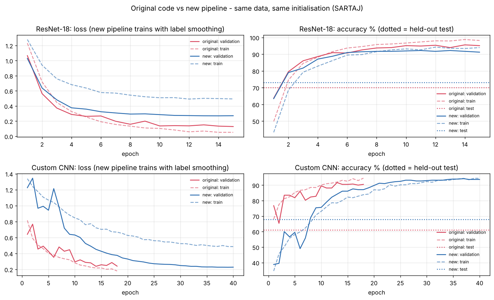

# NeuroScan AI · Brain MRI Tumor Classification & Model Comparison

A research workbench that trains, evaluates and compares four deep-learning models for
classifying brain MRI slices into **glioma, meningioma, pituitary tumor or no tumor**,
and serves them through a web app with calibrated confidence and Grad-CAM explanations.

> **Research and education only.** NeuroScan AI is not a medical device, has not been
> clinically validated and must not be used to diagnose, treat or rule out any condition.

| Model | Type | Parameters |
|---|---|---|
| Custom CNN (v2) | Residual + squeeze-excitation CNN trained from scratch | 1.6 M |
| ResNet-18 | ImageNet transfer learning | 11.3 M |
| MobileNetV3-Small | Efficient CNN for CPU / edge | 1.1 M |
| ViT-B/16 | Vision Transformer | 86 M |

---

## 1. Why the original models over- and under-fitted

Numbers from the shipped checkpoints and `results/*.json` (Kaggle *Brain Tumor MRI* dataset):

| Model | Train acc (last epoch) | Validation acc (selected) | **Test acc** | Validation loss (selected) | **Test log-loss** | Diagnosis |
|---|---|---|---|---|---|---|
| Custom CNN | 89.5 % | 89.4 % | **79.5 %** | 0.319 | **0.637** | under-fitting + poor generalisation |
| ResNet-18 | 99.1 % | 98.7 % | **95.0 %** | 0.041 | **0.314 (7.7x)** | over-fitting hidden by validation |
| MobileNetV3 | 98.7 % | 97.3 % | **93.7 %** | 0.072 | **0.354 (4.9x)** | over-fitting, unstable validation |
| ViT-B/16 | 99.4 % | 98.1 % | **94.3 %** | 0.064 | **0.296 (4.6x)** | over-fitting hidden by validation |

The validation set said "almost perfect" while the held-out test set disagreed, and the
models were near 100 % confident even on misclassified scans. Glioma, the most dangerous
class to miss, had only 56-82 % recall. Root causes found in the code and data:

1. **Leaky validation split.** `random_split` on a training folder full of near-duplicates
   (augmented copies, rescaled scans, adjacent slices) put copies of training images into
   validation. On the SARTAJ subset of this dataset (`scripts/audit_dataset.py`),
   **23.5 % of training images belong to near-duplicate groups** and **69 % of the official
   test images have a near-copy in training** (no-tumor 100 %, meningioma 97 %, pituitary 41 %,
   glioma 23 %); 7 of those pairs even carry different labels. Your test folder also contains
   `Te-aug-*` augmented copies. Early stopping and checkpoint selection were therefore driven
   by memorisation, and test accuracy is optimistic for meningioma / no-tumor.
2. **Checkpoint selection on validation accuracy**, a noisy and saturated signal, with
   patience counted on accuracy as well.
3. **Fine-tuning recipe**: one learning rate for a pretrained backbone *and* a random head,
   no warm-up, `ReduceLROnPlateau` on a noisy signal, weak augmentation, no label smoothing,
   no calibration. This produces 100 % confidence and the validation swings in the curves.
4. **Source shortcuts.** Each class comes mostly from one source dataset with its own zoom,
   black borders and even watermarks (a "Medscape" banner on a no-tumor scan), and every
   scan was stretched to 224x224.
5. **Custom CNN**: 5 epochs at lr 1e-4 from scratch, with 73 % of its parameters in a single
   4096x256 dense layer: too little training for too shallow features.
6. **App-level bug**: `best_vit_model.pth` is git-ignored, so in every fresh clone the
   server silently built a *randomly initialised* ViT and let it vote in the consensus. Its
   vote is an arbitrary constant that changes on every restart (in two test runs it said
   "no tumor" for every scan, then "meningioma" for all 12 samples). With the shipped
   checkpoints the old app reported a **glioma** sample (`Te-gl_1.jpg`) as *"Normal / Healthy
   Brain — All 3 of 4 AI models analyzed this MRI and found normal, healthy brain tissue.
   There are no detectable tumors…"*. The new app excludes missing models, reports this scan
   as **inconclusive**, and its Grad-CAM highlights the tumor.

`results/plots/training_loss_accuracy_curves.png` and the app's **Training health** tab
show the train / validation curves with the held-out test accuracy marked.

## 2. What changed

| Area | Change | Why |
|---|---|---|
| Split | Perceptual-hash near-duplicate groups + `StratifiedGroupKFold` | validation becomes independent of training |
| Leakage | `scripts/audit_dataset.py`, `evaluate.py --exclude-leaked` | measure and report test-set contamination |
| Preprocessing | crop to head, pad to square, resize (stored per checkpoint) | removes framing/watermark shortcuts, keeps aspect ratio |
| Augmentation | random resized crop, flips, affine, contrast/brightness, blur, erasing | regularisation; anatomy-preserving only |
| Recipe | LP-FT, discriminative LRs, warm-up + cosine, AdamW without decaying norms/biases, label smoothing, gradient clipping, EMA | prevents feature distortion and over-confidence, stabilises training |
| Selection | early stopping and checkpointing on validation **loss** | accuracy saturates; loss tracks calibration |
| Calibration | temperature scaling fitted on validation (soften-only, T ≥ 1), saved in checkpoint | over-confident models are corrected; never made more confident |
| Custom CNN | v2: residual blocks + squeeze-excitation + global-pool head, 40 epochs at lr 2e-3 | trains to ~94 % without a train/validation gap instead of plateauing |
| Metrics | ECE, tumor sensitivity / specificity, missed tumors, model-only latency | clinically meaningful view; old latency included disk I/O |
| Ensemble | weights = log-odds of validation accuracy; missing models excluded; inconclusive state | no random voters, honest uncertainty |
| Checkpoints | arch, classes, preprocessing, temperature, val metrics; `weights_only=True` loading | reproducible inference, no pickle code execution |

Old checkpoints still load and run with exactly the preprocessing they were trained with
(verified by a test that compares against the original torchvision transform).

## 3. Evidence: controlled experiment

The **original code (unmodified, from `main`)** and the **new pipeline** were trained on
the same public data with the same ImageNet initialisation and compared on the official
test split and on its *leakage-free* subset (test images with no near-copy in training).
The full Kaggle dataset cannot be downloaded in the sandbox used for this work, so the
experiment uses the [SARTAJ dataset](https://github.com/sartajbhuvaji/brain-tumor-classification-dataset)
(2,870 training / 394 test images), one of the three sources of the Kaggle dataset. Its test
split is distribution-shifted and its glioma labels are known to be noisy, so absolute
numbers are low for every method; the comparison between pipelines is what matters.

**ResNet-18** (15 epochs each):

| | Original code | New pipeline |
|---|---|---|
| Validation accuracy (own split) | 95.6 % | 91.7 % |
| Test accuracy / balanced accuracy | 70.1 % / 67.8 % | **73.1 % / 71.5 %** |
| Test macro F1 | 0.655 | **0.720** |
| Test log-loss / ECE | 1.43 / 0.213 | **0.80 / 0.083** |
| Glioma recall | 0.24 | **0.48** |
| Tumor sensitivity | 0.77 | **0.82** |
| Leakage-free accuracy (124 images) | 21.0 % | **46.8 %** |
| Leakage-free glioma recall | 0.09 | **0.38** |
| Validation → test drop | 25.5 pts | **18.6 pts** |

**Custom CNN** (original v1 with its own early stopping vs. new v2 at its 40-epoch default):

| | Original, 12 epochs | Original, 40 max (stopped at 18) | New, 40 epochs |
|---|---|---|---|
| Validation accuracy (own split) | 89.5 % | 91.6 % | 93.7 % |
| Test accuracy / balanced accuracy | 67.0 % / 66.4 % | 61.2 % / 60.3 % | **67.8 %** / 65.7 % |
| Test macro F1 | 0.625 | 0.572 | **0.654** |
| Test log-loss / ECE | 1.35 / 0.123 | 1.64 / 0.208 | **0.88 / 0.112** |
| Glioma recall | 0.14 | 0.16 | **0.39** |
| Tumor sensitivity | **0.80** | 0.64 | 0.74 |
| Leakage-free accuracy | 33.1 % | 22.6 % | 33.1 % |

What this shows:

* **The original validation numbers cannot be trusted.** Training the original custom CNN
  longer *raised* its validation accuracy (89.5 → 91.6 %) while test accuracy *fell*
  (67.0 → 61.2 %): over-fitting that the leaky split rewards instead of catching.
* **ResNet-18 generalises clearly better with the new pipeline**: higher test accuracy and
  F1, half the log-loss, less than half the calibration error, twice the glioma recall and
  more than twice the accuracy on never-seen scans.
* **The from-scratch CNN improves more modestly**: on-par accuracy with better F1,
  calibration and glioma recall, but lower tumor sensitivity than the best original run. It
  needs its full 40-epoch schedule; cut to 12 epochs it under-fitted (46.5 % test accuracy).
* **Calibration policy.** Temperatures fitted on validation data were below 1 (sharpening,
  because label smoothing makes models slightly under-confident). On the shifted test set,
  sharpening made ECE and log-loss worse for both models, so the shipped policy only lets
  temperature *soften* predictions (T ≥ 1). The new-pipeline numbers above use that policy.
  This choice was made after looking at these test results, which is stated here for
  transparency; it removes a degree of freedom rather than tuning one.

Limits: one seed, CPU-sized budgets, and MobileNetV3/ViT were not re-run because their
ImageNet weights were not reachable in the sandbox. Confirm on the full Kaggle dataset with
`python evaluate.py --tta` and `--exclude-leaked` after retraining.
All numbers, per-epoch histories and the figure are in
[`results/experiments/sartaj_ab/`](results/experiments/sartaj_ab/) (`summary.json`, `histories/`, `curves.png`).



## 4. Quick start

```bash
python -m venv .venv && source .venv/bin/activate      # Windows: .venv\Scripts\activate
pip install -r requirements.txt
python server.py                                        # http://127.0.0.1:8000
```

With `uv`: `uv venv && uv pip install -r requirements.txt && uv run python server.py`.

The repository ships the original Custom CNN, ResNet-18 and MobileNetV3 checkpoints, so the
app works immediately. The ViT checkpoint (330 MB) is git-ignored and is reported as
unavailable rather than guessed. **Retrain with the new pipeline to get calibrated models**
(section 5); the app picks up new checkpoints automatically.

## 5. Training and evaluation

Place the [Kaggle Brain Tumor MRI dataset](https://www.kaggle.com/datasets/masoudnickparvar/brain-tumor-mri-dataset)
in `Dataset/brain-tumor-mri-dataset/{Training,Testing}`, or pass `--data-dir` / set
`NEUROSCAN_DATA_DIR`. Folder names such as `glioma_tumor` or `no_tumor` are mapped automatically.

```bash
python scripts/audit_dataset.py                          # duplicates + train/test leakage report
python train.py --model all                              # recommended recipes (src/config.py)
python train.py --model resnet18 --epochs 20 --lr 5e-4   # override any recipe value
python train.py --model custom_cnn --subset-fraction 0.1 --epochs 2   # quick smoke run
python evaluate.py --tta                                 # test set, per-model + weighted ensemble
python evaluate.py --tta --exclude-leaked --results-dir results/leakage_free
python compare.py                                        # figures in results/plots/
python predict.py sample_scans/glioma/Te-gl_10.jpg       # CLI prediction (add --json)
```

No GPU? `notebooks/Brain_Tumor_Colab_Training.ipynb` clones this repository and runs the same
scripts on a free Colab GPU. For offline machines, `--pretrained-weights path/to/resnet18.pth`
loads ImageNet weights from disk.

Each run writes `models/<name>.pth` (with preprocessing, temperature and validation metrics)
and `results/<name>_history.json` (per-epoch curves, split report, generalisation gap).

## 6. Web app and API

The Diagnose tab shows the ensemble finding with confidence level, a probability spectrum
with the 60 % and 85 % thresholds, an inconclusive state, input warnings, Grad-CAM, and the
per-model breakdown. Other tabs: Benchmark, Error analysis (row-normalised confusion matrix),
Training health (over/under-fitting diagnosis) and Guide. Chart.js and the icon font are
vendored, so the app works offline.

| Endpoint | Description |
|---|---|
| `GET /api/health` | liveness + number of loaded models |
| `GET /api/status` | models, calibration, ensemble weights, class metadata |
| `GET /api/samples` | bundled sample scans |
| `POST /api/predict` | multipart `file` (JPEG/PNG) or `sample_id` → calibrated ensemble result |
| `GET /api/metrics` | evaluation results, histories (never fabricated) |
| `POST /api/refresh` | reload checkpoints (localhost only) |
| `GET /api/docs` | OpenAPI UI |

Configuration through environment variables: `NEUROSCAN_HOST`, `NEUROSCAN_PORT`,
`NEUROSCAN_MAX_UPLOAD_MB` (10), `NEUROSCAN_CORS_ORIGINS` (off), `NEUROSCAN_TTA` (1),
`NEUROSCAN_MODELS_DIR`, `NEUROSCAN_RESULTS_DIR`, `NEUROSCAN_DATA_DIR`.
Uploads are size-limited and validated; sample ids are whitelisted; responses carry a CSP
and other security headers. An optional Gradio UI is available via
`pip install -r requirements-gradio.txt && python app.py`.

## 7. Tests

```bash
pip install -r requirements-dev.txt
pytest
```

43 tests run on synthetic MRI-like images in about 15 s: preprocessing and legacy parity,
duplicate grouping and leak-free splits, checkpoints, calibration, ensembling, an end-to-end
training run and the API's security behaviour. GitHub Actions runs them on every push.

## 8. Repository structure

```text
src/
  config.py         paths, class metadata, per-model training recipes
  preprocessing.py  head cropping, square padding, input sanity checks
  data.py           dataset scan, near-duplicate grouping, leak-free split, loaders
  models.py         architectures, registry, checkpoint format
  training.py       LP-FT training engine with EMA, early stopping, calibration
  calibration.py    temperature scaling
  metrics.py        accuracy, calibration and screening metrics
  ensemble.py       reliability weights and uncertainty assessment
  inference.py      inference service + Grad-CAM (used by server, CLI and Gradio)
train.py · evaluate.py · compare.py · predict.py · server.py · app.py
scripts/audit_dataset.py   dataset duplicate / leakage audit
frontend/                  web UI (vanilla JS, vendored Chart.js and icons)
tests/                     pytest suite
notebooks/                 Colab training + analysis notebooks
```

## 9. Limitations

* Four classes only; "no tumor pattern" does not exclude other pathology.
* Single 2-D slices; clinical reading uses full 3-D, multi-sequence studies.
* Public data with mixed sources and duplicates: expect lower accuracy on new scanners
  and hospitals, and report leakage-free results alongside the standard test set.
* Grad-CAM is a coarse attribution map, not a segmentation.
